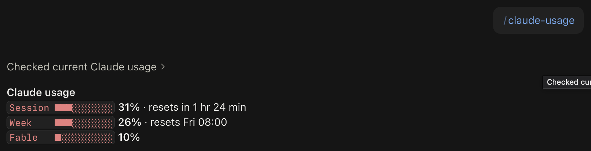

# claude-usage

**Let your Claude agents see their own usage and act on it.**

Claude Code agents can't normally tell how much of their subscription quota is left, so
they work blindly until they hit the limit and fail mid-task. claude-usage gives the agent
that awareness. As a skill, Claude **queries its own usage at any moment** (5-hour
session, weekly, per-model weekly) and plans around it:
- it takes smaller steps and starts fewer parallel agents as the limit nears;
- at **95%** every session and subagent **pauses itself**, and you get a notification;
- after the reset it **resumes on its own**, right where it stopped.

You can run the same check yourself from the terminal. It reuses the login Claude Code
already stored and calls the endpoint behind the CLI's `/usage` screen. It has no
dependencies and needs Node 18+.

```
$ claude-usage
Claude usage · max
  Session   ██████░░░░░░░░░░░░░░  30%  Resets in 1 hr 25 min
  Week      █████░░░░░░░░░░░░░░░  26%  Resets Fri 08:00
  Fable     ██░░░░░░░░░░░░░░░░░░  10%
```

In Claude Code, `/claude-usage` answers like this:



## Quick use

```bash
# as a Claude Code skill (Claude can then answer "how much usage is left?")
git clone https://github.com/serebano/claude-usage ~/.claude/skills/claude-usage

# or run without installing
npx github:serebano/claude-usage
```

```bash
claude-usage                          # one-line summary (local time)
claude-usage --fresh                             # skip the shared 60 s cache
claude-usage --plain                             # one line (default when piped)
claude-usage --json                   # machine-readable
claude-usage --config-dir ~/.claude-2 # a specific CLAUDE_CONFIG_DIR
claude-usage --all                    # every ~/.claude* config dir
claude-usage-monitor --threshold 95   # pause at 95%, notify, resume after reset
claude-usage-monitor --once           # single check, for cron/timers
claude-usage-monitor --on-pause 'say paused' --on-resume 'say resumed'
```

From a clone, use `node bin/claude-usage.mjs` (or `npm link` once to get the commands).
Exit codes: `0` ok, `2` token expired / not logged in, `3` network error.

## Auto pause at 95%, auto resume

The monitor writes `~/.claude-usage/state.json`. The PreToolUse hook
`hooks/pause-guard.mjs` **holds** every tool call while it says `paused` (pauses at 95%, earlier when usage is rising fast, and when it can't be read near the limit; above 80% it also refuses new subagents) and releases it
once the monitor reports `ok` after the reset. Every session and subagent pauses
mid-task and carries on by itself, with no lost work and no restart. The monitor notifies on
pause and on resume and runs `--on-pause` / `--on-resume`. The hook reads only that local
file and fails open. Give it a long `timeout` (604800 s = 7 days) so a hold can outlast
a weekly reset. `CLAUDE_USAGE_GUARD=block` stops the turn instead; `off` disables it.
Enable it with [`examples/settings.hooks.json`](examples/settings.hooks.json); run the
monitor as a service with the launchd/systemd/cron templates in [`examples/`](examples/).
Notifications: macOS Notification Center, `notify-send` on Linux, and Telegram when
`TELEGRAM_BOT_TOKEN` and `TELEGRAM_CHAT_ID` are set.

## How it works

- **Token**: macOS keychain item `Claude Code-credentials` (for a custom
  `CLAUDE_CONFIG_DIR`: `Claude Code-credentials-<first 8 hex of sha256(dir path)>`);
  elsewhere `<config dir>/.credentials.json`. Windows: the same file under
  `%USERPROFILE%\.claude`, best-effort.
- **Request**: `GET https://api.anthropic.com/api/oauth/usage` with
  `Authorization: Bearer <token>` and `anthropic-beta: oauth-2025-04-20`. The `limits[]`
  array gives each limit's percent and reset time.
- It never refreshes the token (refresh tokens rotate and that would log the CLI out).
  An expired token is reported; Claude Code refreshes it on its next request.

## Privacy

The token is read locally and sent only to `api.anthropic.com`. It is never printed,
logged or written to disk. Output contains only usage numbers and reset times.

## Disclaimer

Unofficial and not affiliated with Anthropic. It uses an undocumented endpoint that may
change or disappear without notice.

MIT licensed. See [CHANGELOG.md](CHANGELOG.md).
